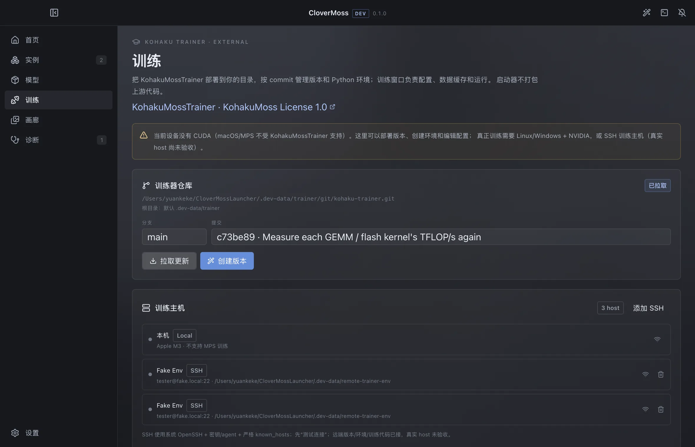
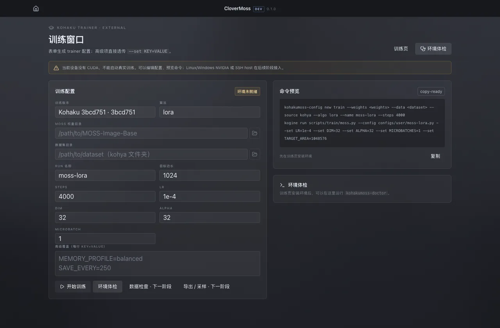

# CloverMoss Launcher

> MOSS-Image 的桌面启动器与工作台：像 Minecraft Launcher 一样选版本、选设备、启动；
> 创作、终端和 Kohaku Trainer 各有独立窗口。

**当前状态：** 本地开发版 `0.1.0`；设计与文档修订号 **v0.4**（修订号不等于应用版本）。
M1–M4 基础、四窗口 UI、画廊、诊断、训练器部署/版本/环境管理与训练窗口代码已落地；
真实 27 GB 权重生成、真实 CUDA 训练、SSH 远端执行尚未验收。


## 现在能做什么

| 能力 | 状态 | 说明 |
| --- | --- | --- |
| 环境报告 | ✅ | 系统/GPU/内存/磁盘/Python/git/网络/端口 + 推荐档位 |
| 实例管理 | 🟡 | bare mirror/worktree/固定 SHA/删除；更新/回滚 UI 未做 |
| 运行时 | ✅ | 共享/独立 venv、依赖锁哈希、uv/pip、安装日志 |
| 模型/适配器 | 🟡 | 目录、下载、HF 缓存；适配器绑定/强度 UI 已接；模型包绑定未做 |
| 画廊 | ✅ | 启动器全局入口；可配置目录；分页 + `content-visibility` |
| 通知/OOBE | ✅ | 单矩形通知抽屉；OOBE 三行环境清单，可本次跳过 |
| 启动条/运行栈 | ✅ | Case/后端/实例/设备/档位/高级；同设备默认排队 |
| 队列落盘 | 🟡 | `launch-queue.json`；queued 保留、running 重启标 failed |
| 官方 Gradio | 🟡 | 代码路径已接；缺 27 GB 权重，未做真机验收 |
| xterm 终端 | ✅ | 推理/训练 Case 共用；stdout/stderr/stdin、停止/重启 |
| 创作台/布局标注 | ✅ | 画布、区域、官方 layout JSON 编译；生成入口未接 |
| 诊断 | ✅ | 规则匹配、去重、toast 预算、解决动作 |
| Kohaku Trainer | 🟡 | 仓库/版本/环境/表单/命令预览/本机 CUDA 训练路径；真实训练未验收 |
| SSH 训练主机 | 🟡 | host CRUD/测试、远端 mirror/worktree/venv/train 代码；仅 fake ssh 验证 |
| Clover 常驻后端 | ⬜ | 未实现；创作窗口“开始生成”暂不接任务 |
| Project/图层 | ⬜ | 创作文档仍只在内存；Project 与 Case 解耦的设计未落地 |
| WebUI/应用内更新 | ⬜ | 未实现 |

> 完整、可核对的完成度与证据见 [docs/status.md](docs/status.md)。README 只做总览，
> 不把“代码路径存在”写成“已验收”。

## 四窗口

| 窗口 | 尺寸 | 负责 |
| --- | --- | --- |
| **启动器** | 1180×760 | 首页启动条/运行栈、实例、模型、画廊、训练、诊断、设置、OOBE |
| **创作** | 1320×860 | Studio、layout 画布、JSON 编译、画廊 |
| **终端** | 1120×720 | Cases 列表 + xterm；推理与训练共用 |
| **Kohaku Trainer** | 1280×840 | 外部训练器配置、命令预览、doctor、训练运行 |

四个窗口共用同一套 React 前端和深灰亚克力 token。标题栏居中显示应用名 +
`dev/release` + 版本号；启动器窗口没有侧栏 Logo。


## 启动器：启动条与运行栈

```text
[Case] [后端：官方 Gradio / Clover（占位）] [实例] [设备] [档位] [高级] [启动]
```

- 启动条固定在首页底部、固定宽度（约 880 px）并在主区域居中；
- 启动后这一条锁定为 `停止 / 终端 / 打开界面 / 运行中`；
- 上方新增一条新的空白启动条；
- 运行中的 Case 收在启动条上方的折叠任务表里，可按名称/启动时间排序；
- 同设备默认只跑 1 个真实任务，其余排队。**Case 配置写入 `cases.json`；
  排队只在当前启动器会话内，重启丢失**；
- 设备自动枚举 Apple MPS / NVIDIA CUDA / CPU；设备维护页未做；
- `official` 后端启动实例里的 `gradio_app.py`；`Clover` 常驻后端未实现。


## 创作、画廊、终端

- **创作窗口**：Studio 支持 layout 画布、区域增删/移动/缩放、官方 layout JSON
  编译与 Prompt 插入；当前“开始生成”不接 Clover 后端。
- **画廊**：启动器侧栏的全局工具；读取 outputs、实例 outputs 与自定义目录；
  48 张/页 + IntersectionObserver + `content-visibility`；支持详情、元数据、
  “用作布局底图”跨窗口交接。
- **终端**：独立 xterm 窗口；左侧 Cases，右侧 stdout/stderr/stdin；
  推理与训练任务都进入同一列表，行上标 `推理 / 训练`。


## Kohaku Trainer（外部）

- 训练页把 `KohakuBlueleaf/KohakuMossTrainer` runtime clone 到用户配置的
  `trainerRoot`；**不打包、不 submodule**；
- bare mirror + per-commit worktree；环境按 lock hash 创建/复用；
- Training 页支持仓库更新、commit 选择、创建版本、安装环境、`kohakumoss-doctor`；
- Trainer 窗口支持版本/权重/数据集/算法/steps/LR/Dim/Alpha/microbatch/分辨率/
  高级覆盖、命令预览；
- CUDA 主机上走训练/检查数据/缓存文本/潜变量路径（代码已接，真实 CUDA 未验收）；
  训练 job 进入共享终端，解析 step/loss；导出/采样目前是可复制的命令入口；
- SSH host 可增删/测试并持久化；系统 OpenSSH + 密钥/agent、远端 mirror/worktree/venv/train 代码已接，**真实 host 未验收**；
- 本机 M3 没有 CUDA：只能部署/管理/编辑，不能真实验收训练。





## 视觉规范

- 中性深灰亚克力，不用深蓝底、不用蓝色渐变、无绿色；
- 冷调浅蓝白文字，浅蓝只做激活/焦点/少量图标；
- 标题栏/侧栏薄亚克力，内容区后亚克力，卡片更薄；背景图铺满右侧主区域
  并进入所有页面与终端；
- 首页 16:9 背景图可在设置里更换，默认占位图：
  `apps/desktop/src/renderer/src/assets/home-background.webp`；
- Fluent 2 取向：控件 4–6 px 圆角、约 30 px 高、宽度随文字；启动条使用
  Apps SDK UI Select；
- 通知固定在右上角、单个大矩形，用标题/段落/发丝线分区；
- 只保留深色主题；浅色主题已移除（设置 schema 中的 `theme` 仅作迁移残留）。

## OOBE

启动时检查是否至少有一个实例满足 `runtime ready + 模型可用`：

- 不满足 → **每次启动**默认弹出单页三行清单：实例 / 运行时 / 模型；
- 可关闭（本次跳过）；下次启动仍不完整会再出现；
- 每行直接给动作，不做多步向导，不滥用圆角。

## 快速开始

```bash
pnpm install
pnpm dev
```

构建与自检：

```bash
pnpm build
pnpm typecheck

env -u ELECTRON_RUN_AS_NODE pnpm --filter @clover/desktop exec electron . --smoke
```

> 部分 harness 会设置 `ELECTRON_RUN_AS_NODE=1`，需要临时去掉。
> 开发数据写在 `.dev-data/`（已忽略），不会碰真实用户目录。

## 仓库结构

```text
apps/desktop/
  src/main/
    windows.ts          启动器 / 创作 / 终端 / Kohaku Trainer 四窗口
    services/           env / network / git / runtimes / instances / models /
                        updates / gallery / supervisor / parsers / diagnostics /
                        devices / cases / onboarding / trainerGit / trainers / trainingHosts /
                        remoteTrainer / ssh / launchQueue / trainerArtifacts
  src/preload/          contextBridge（windowKind / acrylic / channel）
  src/renderer/
    src/pages/          Home / Studio / Gallery / Terminal / Training / TrainerWindow /
                        Instances / InstanceDetail / Models / Diagnostics / Settings
    src/components/     AppTitlebar / layout / NotificationPanel / Oobe / ui
    src/lib/            layout 编译器 / clover / windows / api / format / i18n
  src/shared/           types / channels / zod schemas
runner/                 薄 Python runner（NDJSON + --simulate）
release/                更新源、公告、模型目录、错误规则
docs/                   产品、架构、状态、路线图、layout 规范、ADR、截图
```

## 文档

**事实来源顺序：** [status.md](docs/status.md)（做了什么/验证了什么）→
[architecture.md](docs/architecture.md)（怎么实现）→
[product-design.md](docs/product-design.md)（为什么/产品形态）→
[roadmap.md](docs/roadmap.md)（接下来做什么）。文档索引与维护规则见
[docs/README.md](docs/README.md)。

- [文档索引](docs/README.md)
- [产品设计](docs/product-design.md)
- [架构](docs/architecture.md)
- [实现状态](docs/status.md)
- [路线图](docs/roadmap.md)
- [Layout JSON 规范](docs/layout-schema.md)
- [Runner](runner/README.md)
- [决策记录](docs/decisions/0003-launcher-first.md)
- [未来推理引擎（V2，未排期）](docs/future-inference-engine.md)

## 已知边界

- 真实 27 GB SFT 生成未验收；官方 Gradio 只验证了预检代码路径；
- 真实 CUDA 训练未验收；`startTrainingJob` 用模拟输出/fake ssh 验证过 step/loss 链路；
  远端环境安装/doctor 用 fake uv 验证；
- SSH 远端执行/导出采样只有 fake ssh 验证，真实 host/CUDA 未验收；
  Clover 常驻后端、Project/图层、设备维护、WebUI、应用内更新、打包/公证未实现；
- DMD 8 步 profile 目前只透传，仍走官方 pipeline；真正 8 步采样器未实现；
- Windows 未实机验证；
- 开发渲染 CSP 仍允许 `unsafe-eval`，打包前需要收紧。

## 许可

本仓库代码 MIT。MOSS-Image 权重与代码为 Apache-2.0。
不包含 KohakuMossTrainer 代码；训练窗口明确标注为外部项目，并展示其
KohakuMoss License 1.0。
