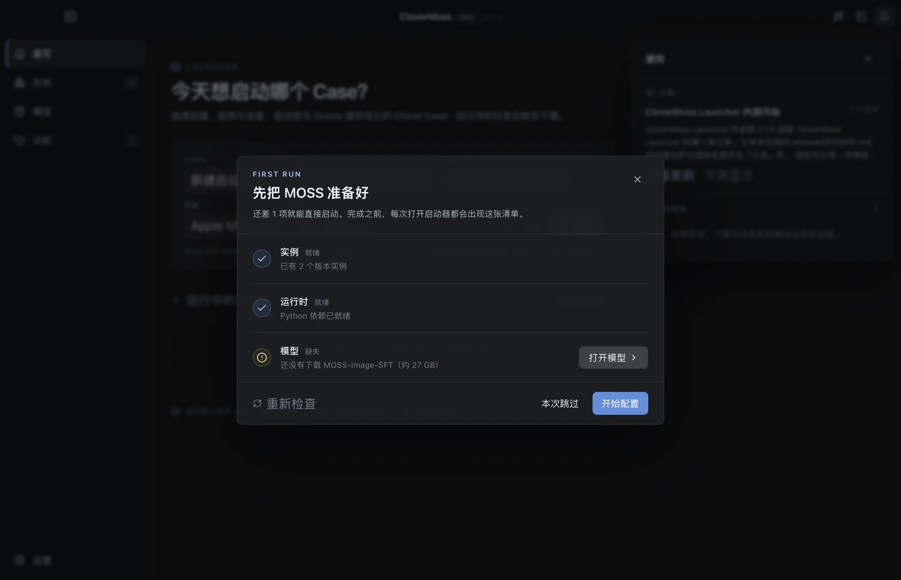
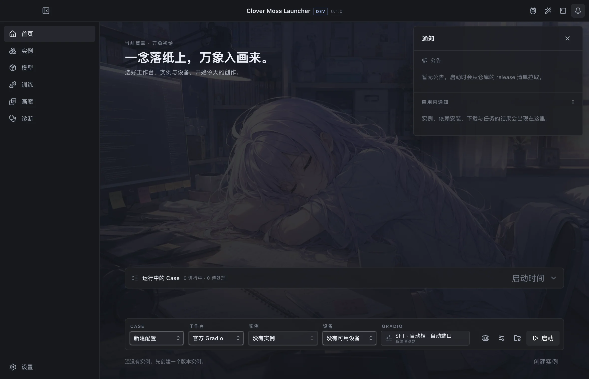
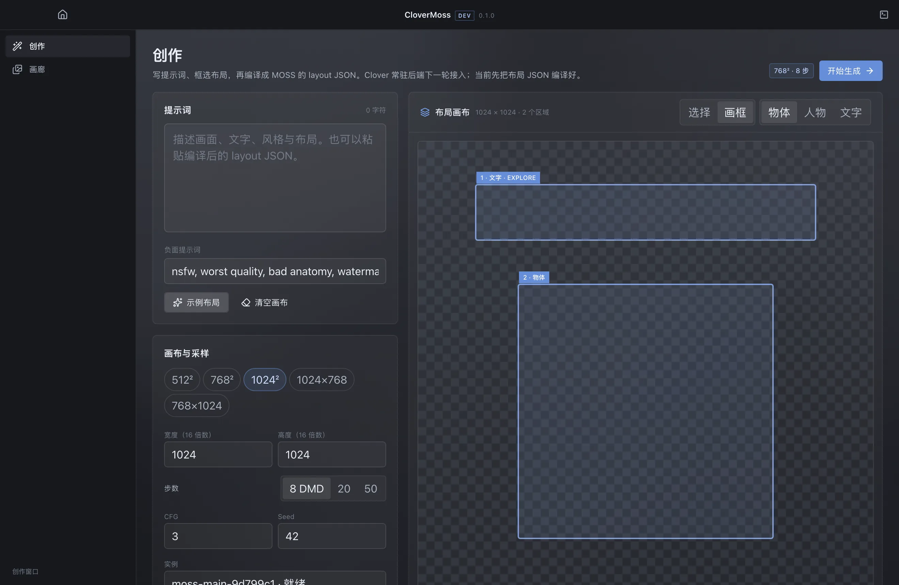
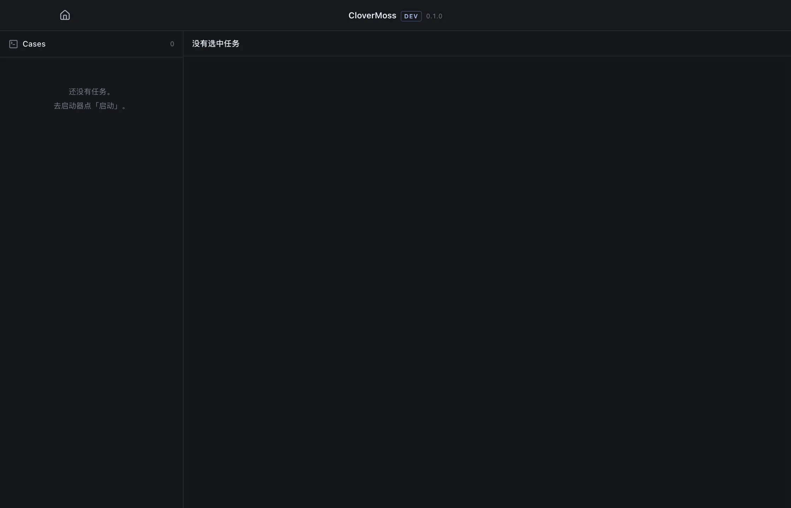

# CloverMoss Launcher

> 为 [MOSS-Image](https://github.com/OpenMOSS/MOSS-Image) 做的跨平台启动器：
> 像 Minecraft Launcher 一样选版本、选设备、启动；创作和终端各有一个独立窗口。

**状态：v0.3 三窗口启动器。** 启动器 / 创作 / 终端可分可合；OOBE、启动条、运行栈、
官方 Gradio 启动、xterm 终端已落地。Clover 常驻后端和 Project 持久化在下一轮。



## 三窗口

| 窗口 | 负责 |
| --- | --- |
| **启动器** | 首页启动条、运行栈、实例、模型、诊断、设置、OOBE |
| **创作** | Studio、layout 画布、JSON 编译、画廊 |
| **终端** | 左侧 Case 列表、右侧 xterm、stdout/stderr/stdin |

窗口共用同一套 React 前端和深灰亚克力 token；标题栏居中显示 `CloverMoss` +
`dev`/`release` + 版本号，没有侧栏 Logo。



## 启动条与运行栈

```text
[Case] [后端：官方 Gradio / Clover] [实例] [设备] [档位] [⚙] [启动]
```

- 启动条固定在首页底部，低高度、宽幅；启动后这一条锁定为 `运行中 / 停止 / 终端 / 打开界面`；
- 上方永远保留一条新的空白启动条；
- 运行中的 Case 收在下方，可折叠、按名称或启动时间排序；
- 同设备默认只跑 1 个真实任务，其余排队；可在高级里强制并发（后续）；
- 设备列表自动枚举（Apple MPS / NVIDIA CUDA / CPU），暂不做维护页；
- 官方 Gradio 由实例里的 `gradio_app.py` 启动；Clover 常驻后端下一轮接入。

## 视觉

- 中性深灰亚克力，不用深蓝底、不用蓝色渐变；
- 文字为冷调浅蓝白，浅蓝只做激活/焦点/少量图标；
- 标题栏/侧栏薄亚克力，内容区后亚克力，卡片更薄；
- 启动条用 Apps SDK UI Select；按钮/分段控件按 Fluent 2 收紧到 30–32 px、4–6 px 圆角，宽度随文字伸展；
- 通知是右上角单独的大矩形，用标题/段落/发丝线分区；与底部启动条不在一个视觉层级；
- 只保留深色主题，浅色主题已移除。





## OOBE

启动时检查：至少一个实例满足 `runtime ready + 模型可用`。

- 不满足 → 每次启动默认弹出单页三行清单：实例 / 运行时 / 模型；
- 可关闭（本次跳过），下次启动仍不完整会再出现；
- 每行直接给动作，不滥用圆角，不做多步向导。

## 已有能力

| 能力 | 状态 |
| --- | --- |
| 环境报告 / 网络镜像 / 公告更新 | ✅ |
| git 实例（固定 commit、稳定版标记） | ✅ |
| 共享/独立运行时 + 依赖安装 | ✅ |
| 模型/适配器目录与 HF 缓存下载 | ✅ |
| 创作台 + 官方 layout JSON 编译器 | ✅（生成下一轮） |
| 画廊（分页 + content-visibility + clover 协议） | ✅ |
| Supervisor + 薄 runner + tqdm/错误解析 + 诊断 | ✅（真实 27GB 权重待验收） |
| 官方 Gradio 启动 | ✅ 代码路径，缺权重时预检拦截 |
| xterm 终端 | ✅ |
| Clover 常驻后端 / Project 持久化 / WebUI | ⏳ 下一轮 |

## 快速开始

```bash
pnpm install
pnpm dev
```

构建与自检：

```bash
pnpm build
pnpm typecheck

env -u ELECTRON_RUN_AS_NODE pnpm --filter @clover/desktop exec electron . --smoke
```

> 部分 CI / harness 会设置 `ELECTRON_RUN_AS_NODE=1`，需要像上面那样临时去掉。
> 开发数据在 `.dev-data/`（已忽略）。

## 结构

```text
apps/desktop/
  src/main/
    windows.ts          启动器 / 创作 / 终端三窗口
    services/           env / git / runtimes / instances / models / gallery /
                        supervisor / parsers / diagnostics / devices / cases / onboarding
    ipc.ts              类型化 IPC + zod
  src/preload/          contextBridge（windowKind / acrylic / channel）
  src/renderer/
    src/pages/          Home / Studio / Gallery / Terminal / Instances / Models / Diagnostics / Settings
    src/components/     AppTitlebar / layout / NotificationPanel / Oobe / ui
    src/lib/            layout 编译器 / clover / windows / api
runner/                 薄 Python runner（NDJSON + simulate）
release/                更新源、公告、模型目录、错误规则
docs/                   产品、架构、状态、layout 规范、截图
```

## 文档

- [产品设计](docs/product-design.md)
- [架构](docs/architecture.md)
- [实现状态](docs/status.md)
- [Layout JSON 规范](docs/layout-schema.md)
- [Runner](runner/README.md)
- [路线图](docs/roadmap.md)

## 已知限制

- Clover 常驻后端、Project 持久化、图层系统在下一轮；
- 创作窗口的“开始生成”目前提示下一轮，不直接起任务；
- Cases 与排队只在本次启动器会话内保存，重启丢失；
- 官方 Gradio 真实启动需要 27 GB SFT 权重，本机未下载，未做真机验收；
- Windows 未实机验证。

## 许可

本仓库代码 MIT。MOSS-Image 权重与代码为 Apache-2.0；不包含 KohakuMossTrainer 代码。
