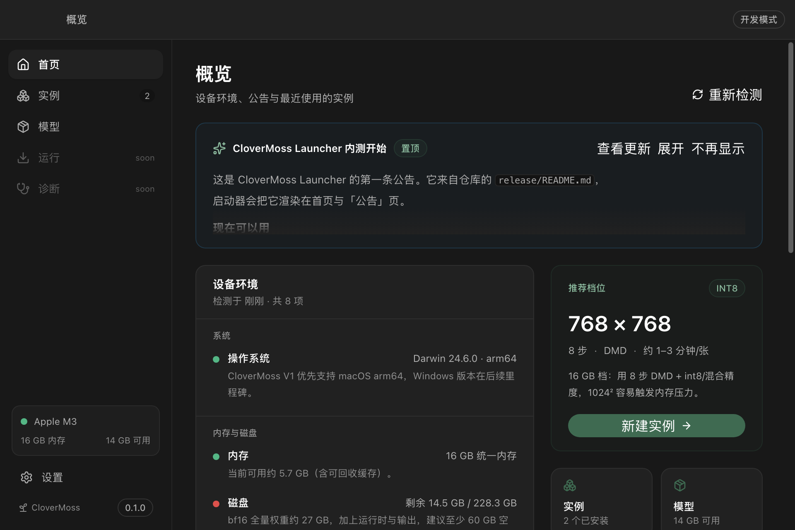

# CloverMoss Launcher

> 为 [MOSS-Image](https://github.com/OpenMOSS/MOSS-Image) 做的跨平台启动器：
> 装得快、版本分得清、权重不迷路、进度看得懂、报错能修、更新不用盯 GitHub。

**状态：M1–M3 开发版可运行。** 已实现环境报告、公告/更新检查、git 实例管理器、
共享/独立运行时、模型/适配器目录与 HF 兼容下载。运行、进度翻译与诊断是 M4 的内容。



## 它解决什么

MOSS-Image 是 5B DiT + Qwen3.5-9B 文本编码器 + FLUX.2 VAE 的文生图模型，
官方形态是「git clone → 装 Python 依赖 → 跑 gradio_app.py」。对普通用户来说：

- 不知道自己的机器能不能跑、该用多大分辨率；
- 多个 commit / 分支 / LoRA 互相污染；
- 27 GB 权重下载没有队列、断点、镜像；
- tqdm 进度只在终端里，报错是几百行 traceback；
- 官方更新了，只能自己刷 GitHub。

启动器把这些收进**一个 960×640 的小窗口**：首页给环境报告和公告，实例页管理版本，
模型页管理权重与 LoRA，运行页（M4）给进度和控制台，诊断页（M4）给可点击的解决方案。

## 现在能做什么

| 能力 | 状态 | 说明 |
| --- | --- | --- |
| 设备环境报告 | ✅ | 系统 / GPU（Metal/CUDA）/ 内存 / 磁盘 / Python / git / 网络 / 端口，附推荐档位 |
| 公告与更新检查 | ✅ | 读取 `/release` 的清单与 markdown；支持镜像、缓存、已读 |
| 实例管理器 | ✅ | bare 镜像 + worktree，固定 commit；`main` HEAD 或推荐提交标为稳定版 |
| 共享/独立运行时 | ✅ | 按依赖锁哈希复用；`uv`/`venv` + `uv pip`/`pip`；日志事件与状态机 |
| 模型/适配器目录 | ✅ | 官方权重、社区 int8/int4、DMD；HF API 文件树、断点续传、sha256、暂停/继续 |
| HF 兼容缓存 | ✅ | `blobs / snapshots / refs`，官方 diffusers 代码零改动命中 |
| 自动换源 | ✅ | 探测 GitHub / PyPI / HuggingFace，按延迟选镜像，可在设置覆盖 |
| 运行 / 进度 / 诊断 | ⏳ M4 | runner、Gradio、tqdm 翻译、错误卡片 |
| WebUI / 更新安装 | ⏳ M5 | 浏览器模式、应用内更新 |

更多实现细节与实测数据见 [docs/status.md](docs/status.md)。

## 快速开始

需要 Node 20+、pnpm 9+。首次启动会自动扫描环境，不会下载权重。

```bash
pnpm install
pnpm dev
```

构建与自检：

```bash
pnpm build
pnpm typecheck

# 无窗口自检：环境 + 公告 + 目录
env -u ELECTRON_RUN_AS_NODE pnpm --filter @clover/desktop exec electron . --smoke
```

> 某些 CI / harness 会设置 `ELECTRON_RUN_AS_NODE=1`，此时 Electron 会以 Node 运行，
> 需要像上面那样临时去掉。普通桌面环境不需要。

开发数据写在仓库内 `.dev-data/`（已忽略），不会碰真实用户目录。

## 技术栈

- **Electron 44 + TypeScript + React 19**，`electron-vite` 构建；
- **UI：`@openai/apps-sdk-ui`**（MIT，Tailwind 4 + Radix 底座）+ 自定义 Moss 强调色；
- 主进程：类型化 IPC + zod 校验 + 领域服务（env / network / git / runtimes / instances /
  models / updates），当前用 JSON 持久化，M4 换 SQLite；
- 渲染层：Zustand + React Router；
- 外部程序：git、Python（系统或托管）、uv/pip，全部经 Supervisor 边界调用。

## 仓库结构

```
apps/desktop/
  src/main/          Electron 主进程 + 领域服务 + IPC
  src/preload/       contextBridge（只暴露 invoke / on）
  src/renderer/      React UI（M5 做 WebUI 时抽到 apps/renderer）
  src/shared/        类型、channel、zod schema
release/             更新源：manifest.json、公告 README、模型目录、错误规则
contracts/           协议与 schema（release / runner / job）
docs/
  product-design.md  产品设计文档
  architecture.md    架构文档
  status.md          M1–M3 实现状态与实测
  roadmap.md         里程碑
  decisions/         ADR
  model-notes.md     模型事实与数值约定（预算依据）
docs/assets/         UI 截图
tools/budget.py      算力 / 显存预算工具
```

## 文档

- [产品设计](docs/product-design.md)：用户、界面、流程、错误策略、视觉规范；
- [架构](docs/architecture.md)：进程模型、数据模型、git/运行时/下载/监督/解析/更新；
- [实现状态](docs/status.md)：已完成、实测证据、与设计的差异、下一步；
- [路线图](docs/roadmap.md)：M0–M6 与验收标准；
- [Runner 协议](contracts/runner-protocol.md)、[更新清单 schema](contracts/release-manifest.schema.json)；
- [模型事实](docs/model-notes.md)：为什么 16 GB 机器必须用 8 步 DMD。

## 不做什么（V1）

- **不做自有推理后端**：运行官方 Python 代码；引擎是 V2 的事，见
  [ADR-0003](docs/decisions/0003-launcher-first.md) 与
  [未来引擎架构](docs/future-inference-engine.md)。
- 不做训练 UI（训练器以外部进程接入，见 [ADR-0002](docs/decisions/0002-trainer-backend.md)）。
- 不做 img2img / 移动端 / 云账号。

## 许可

本仓库代码 MIT（见 [LICENSE](LICENSE)）。MOSS-Image 权重与代码为 Apache-2.0。
参考实现（mlx-serve、moss-image-swift）为 MIT，只做行为对照。
不包含 KohakuMossTrainer 代码。
