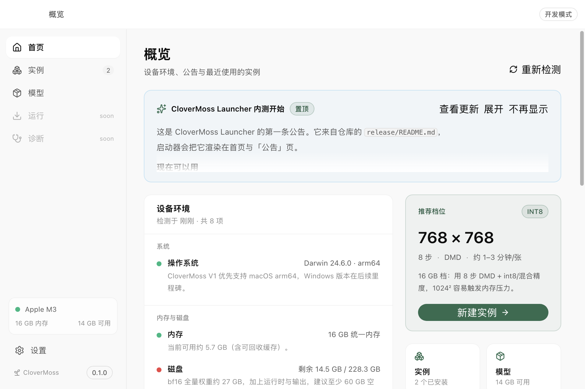
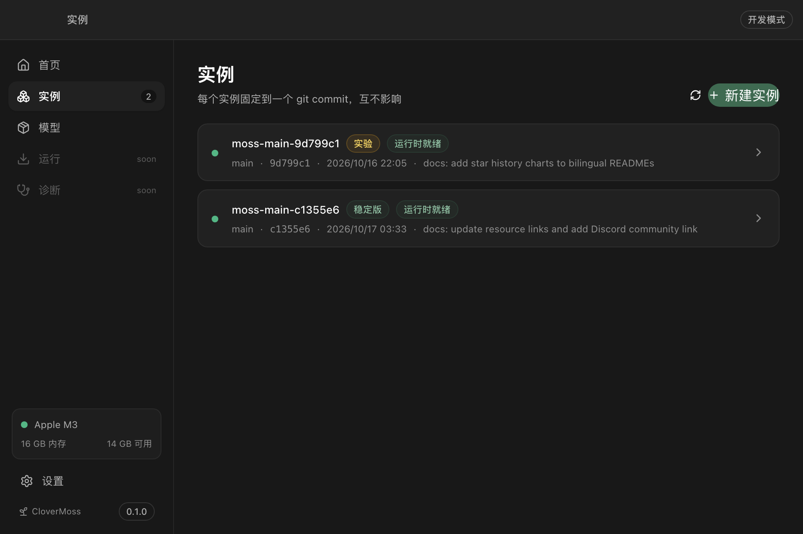
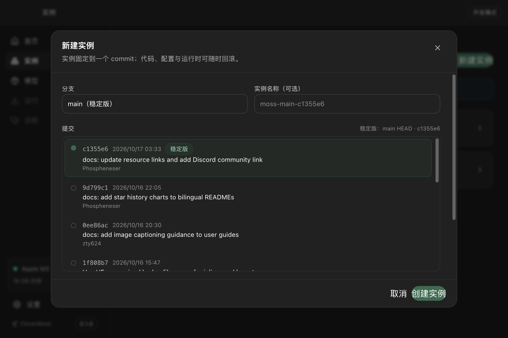
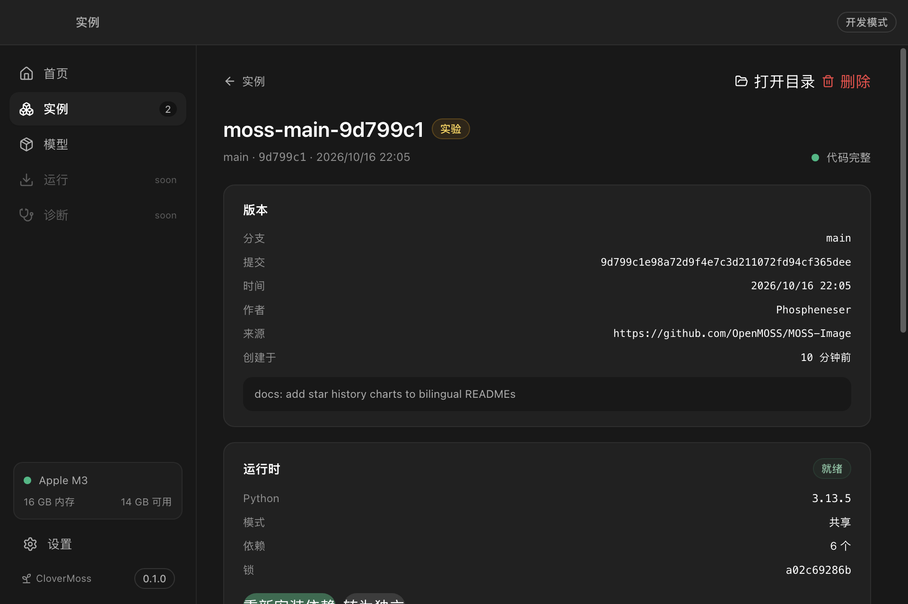
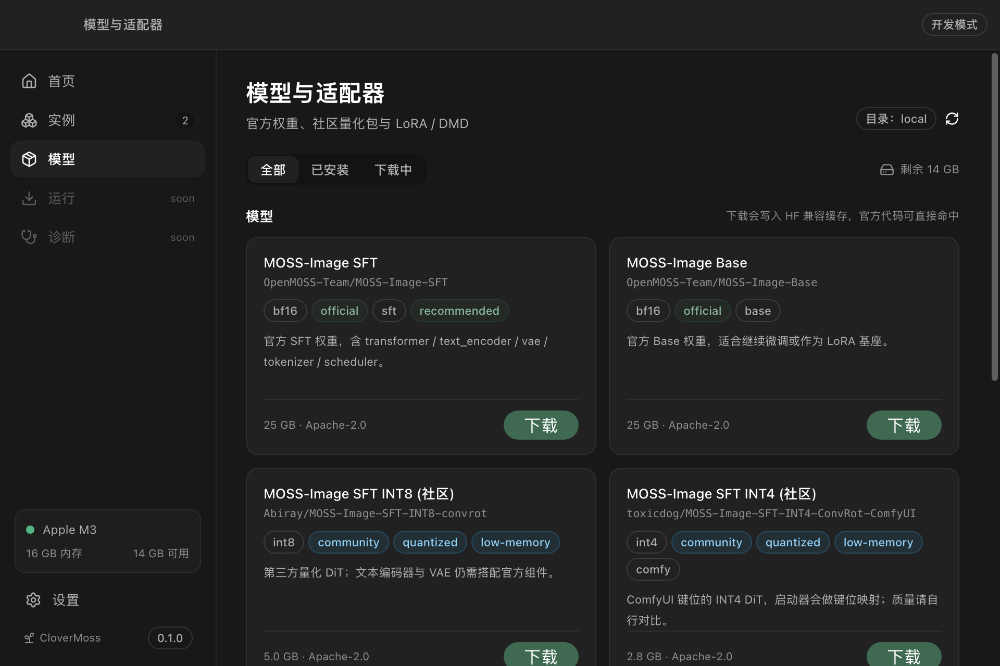
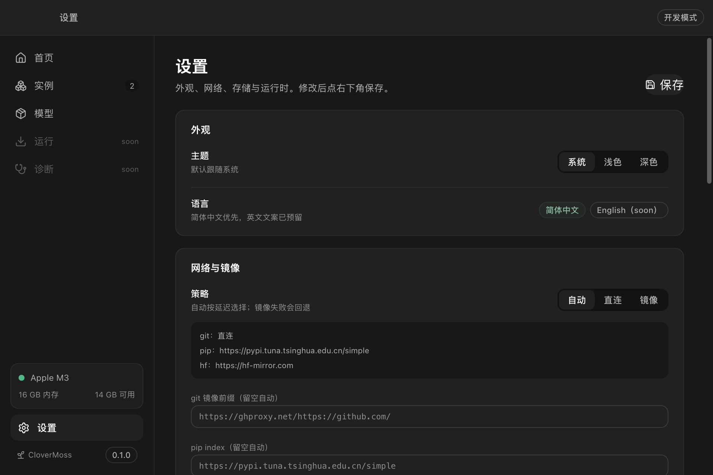

# 实现状态（M1–M3）

- 日期：2026-10-19
- 范围：可运行的 Electron 启动器骨架 + 环境报告 + 公告/更新检查 + 实例/运行时 + 模型目录/下载
- 对应路线图：[M1 / M2 / M3](roadmap.md)

## 1. 现在能跑什么

```bash
pnpm install
pnpm dev                 # 开发模式，窗口 960×640
pnpm build               # 构建 main / preload / renderer
```

开发数据写在仓库内 `.dev-data/`（已 gitignore），不会碰用户目录。
若环境里设置了 `ELECTRON_RUN_AS_NODE=1`（部分 CI / harness 会这样），启动时需临时去掉：

```bash
env -u ELECTRON_RUN_AS_NODE pnpm --filter @clover/desktop exec electron . --smoke
```

## 2. 已完成

| 模块 | 实现 |
| --- | --- |
| 应用壳 | Electron 44 + electron-vite 6 + React 19 + Tailwind 4 + `@openai/apps-sdk-ui`；960×640 小窗、hiddenInset 标题栏、深浅色 |
| IPC | preload 仅暴露 `invoke` / `on`；主进程 zod 校验；`IpcResult` 统一错误 |
| 环境报告 | 系统/CPU/内存（vm_stat 可回收内存）/磁盘/GPU（macOS system_profiler、Windows CIM、Linux lspci）/Python 发现/git/uv/网络探测/7860 端口；按内存给出推荐档位 |
| 公告与更新 | 读取 `release/manifest.json`（开发期本地优先）与公告 markdown；支持多镜像、缓存、已读/不再显示 |
| 实例管理 | bare git 镜像、分支/提交列表、worktree 创建、固定 commit、稳定版标记（main HEAD 或 manifest 推荐提交）、删除/保留输出、dirty 检测 |
| 运行时 | Python 发现、`uv venv`/`venv`、按依赖锁哈希共享、独立运行时、`uv pip`/`pip` 安装、日志事件、状态机 |
| 模型/适配器 | 读取 `release/models.json`，展示官方/社区量化/DMD；HF API 文件树、断点续传、LFS sha256 校验、HF 兼容缓存（blobs/snapshots/refs）、暂停/继续、磁盘保护 |
| 设置 | 主题、网络策略与手动镜像、模型目录、Python 路径、更新开关、版本信息 |
| 安全 | contextIsolation、sandbox、无 nodeIntegration、CSP、外链只走系统浏览器、路径白名单、更新清单 schema |

## 3. 实测证据

在本机 **Apple M3 / 16 GB / macOS 15.7.7** 上验证：

| 验证 | 命令 | 结果 |
| --- | --- | --- |
| 构建 | `pnpm build` | main 70 KB、preload 0.5 KB、renderer 1.65 MB + 172 KB CSS |
| 类型 | `pnpm typecheck` | 通过 |
| 自检 | `electron . --smoke` | 8 项检查；GPU=Apple M3；Python 3.13.5/3.12.7/3.11.9/3.10.18；网络选中清华 PyPI + hf-mirror |
| 公告 | `--smoke` | 本地 manifest → 1 条公告，source=local |
| 实例 | `--scenario=create` | 克隆 96 MB 镜像，创建 worktree，`moss-main-c1355e6`，稳定版 |
| 共享运行时 | `--scenario=second` | 旧 commit 实例复用同一 runtime `py3135-a02c6928` |
| 依赖安装 | `--scenario=install` | 43 个包、785 MB；torch 2.14.1、diffusers 0.41.0、transformers 5.20.1；`torch.backends.mps.is_available() == True`；官方 `inference_runtime` 可 import |
| 模型下载 | `--scenario=download-test` | 10 个文件 / 12.5 MB；HF 缓存布局正确；`transformers` 在 `HF_HUB_OFFLINE=1` 下可解析 |

截图（由 `--screenshot` 自动生成）：









## 4. 与设计文档的差异（有意为之）

1. **渲染层暂放在 `apps/desktop/src/renderer`**，不是独立的 `apps/renderer`。M5 做 WebUI 时抽出，避免现在引入 workspace 解析复杂度。
2. **状态用 JSON 文件而非 SQLite**（`settings.json`、`instance.json`、`runtime.json`）。实例量小，JSON 足够；M4 接任务/日志时再上 SQLite。
3. **下载队列只在内存**，重启后丢失；已完成的缓存保留。M4 持久化。
4. **模型/适配器只做了目录与下载**，实例的模型绑定、适配器启用/强度 UI 留到 M4。
5. **未实现 runner/Gradio 启动、进度翻译、诊断卡片、WebUI、应用更新安装**——这些是 M4/M5。

## 5. 开发辅助

```bash
# 无窗口自检（环境 + 公告 + 目录）
env -u ELECTRON_RUN_AS_NODE pnpm --filter @clover/desktop exec electron . --smoke

# 创建实例 / 复用共享运行时 / 安装依赖
... electron . --scenario=create
... electron . --scenario=second
... electron . --scenario=install

# 下载一个 12 MB 的 HF 测试仓库（验证缓存布局）
... electron . --scenario=download-test

# 生成 5 张界面截图到 .dev-data/
... electron . --screenshot
```

> `--scenario=*` 与 `--screenshot` 仅用于开发；发布包不暴露入口。

## 6. 下一步（M4）

- runner + NDJSON 协议、Gradio 适配器；
- tqdm/ANSI 解析、阶段化进度、stdin；
- 诊断规则与弹窗预算（防循环）；
- 任务/日志落盘（SQLite）；
- 实例模型绑定与适配器强度；
- 下载队列持久化与速度统计。
