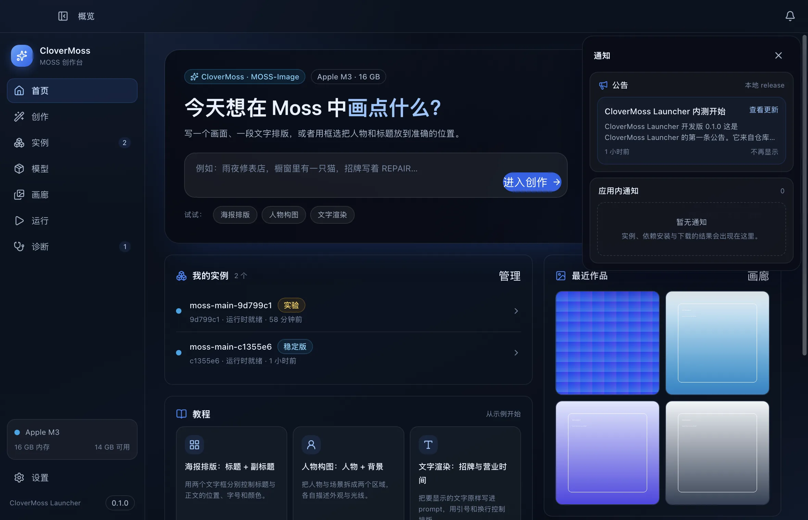
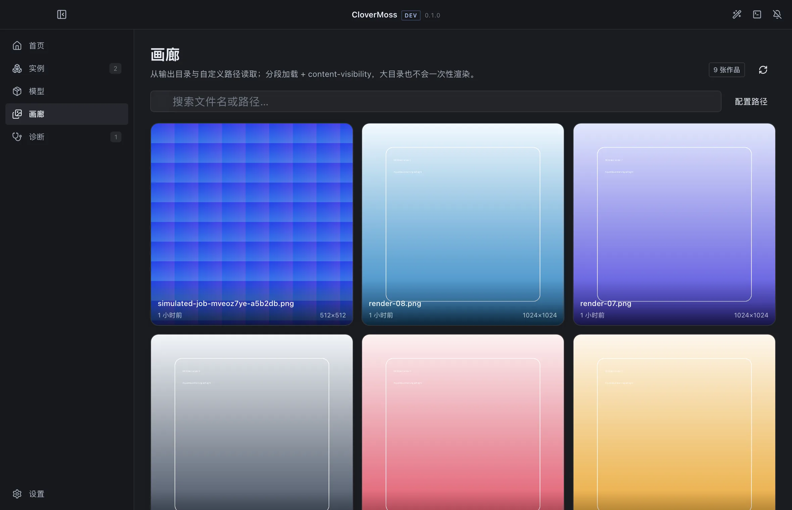
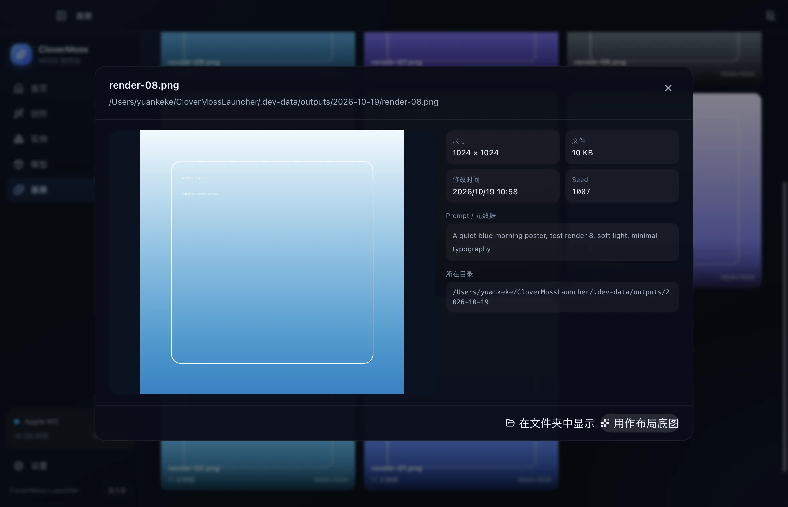
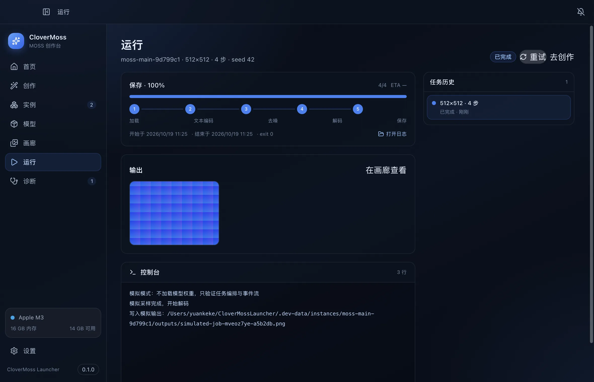
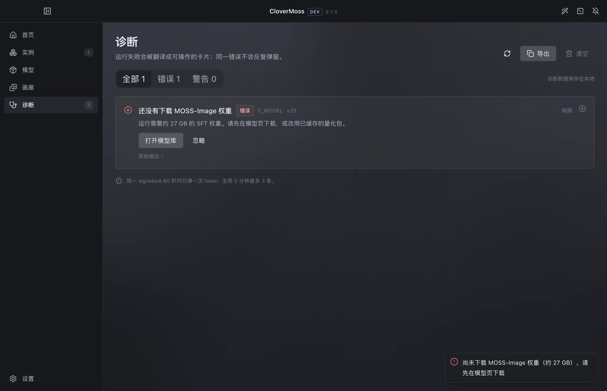
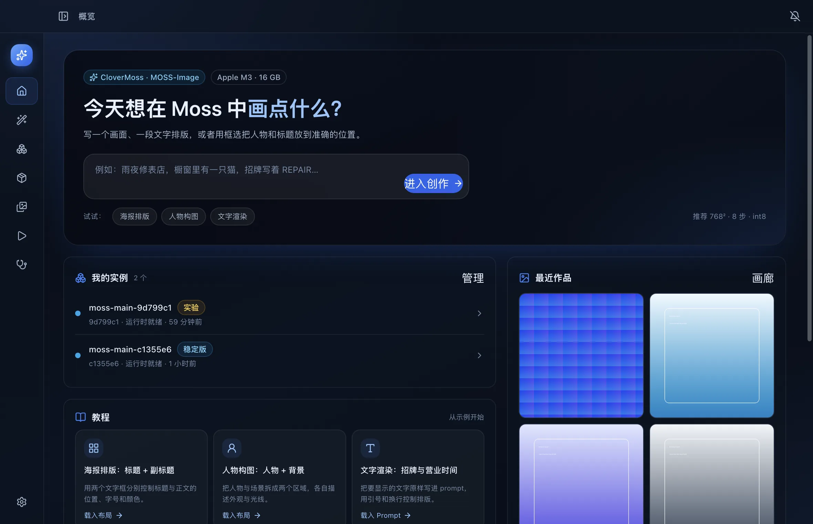
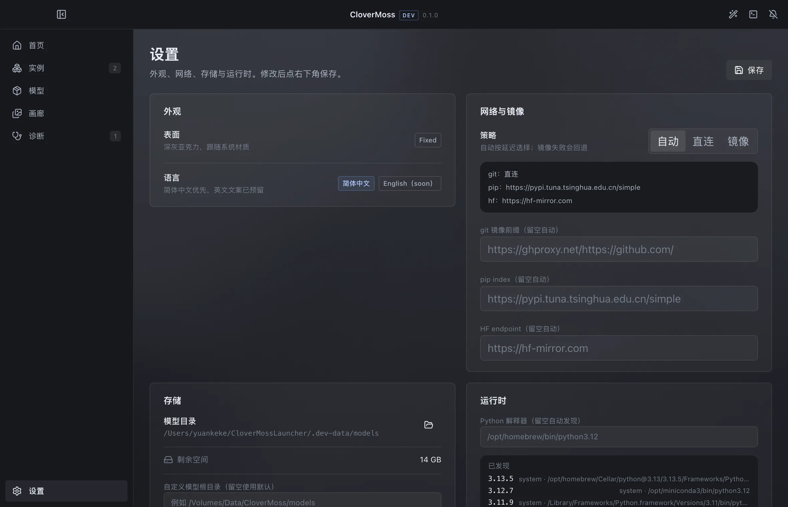

# 实现状态（M1–M4 + UI v0.2）

- 日期：2026-10-19
- 范围：Electron 启动器、环境报告、公告/更新、实例/运行时、模型/下载、
  通知中心、画廊、创作台与 layout 标注器、runner 编排/进度/诊断
- 对应路线图：[M1 / M2 / M3](roadmap.md)

## 1. 现在能跑什么

```bash
pnpm install
pnpm dev                 # 开发模式，默认 1180×760 小窗（非全屏）
pnpm build               # 构建 main / preload / renderer
```

开发数据写在仓库内 `.dev-data/`（已 gitignore），不会碰用户目录。
若环境里设置了 `ELECTRON_RUN_AS_NODE=1`（部分 CI / harness 会这样），启动时需临时去掉：

```bash
env -u ELECTRON_RUN_AS_NODE pnpm --filter @clover/desktop exec electron . --smoke
```

## 2. 已完成

### 2.1 基础（M1–M3）

| 模块 | 实现 |
| --- | --- |
| 应用壳 | Electron 44 + electron-vite 6 + React 19 + Tailwind 4 + `@openai/apps-sdk-ui`；1180×760、hiddenInset、深浅色 |
| IPC | preload 仅暴露 `invoke` / `on` / `acrylic`；主进程 zod 校验；`IpcResult` 统一错误 |
| 环境报告 | 系统/CPU/内存（vm_stat 可回收）/磁盘/GPU（system_profiler、CIM、lspci）/Python/git/uv/网络/7860；推荐档位 |
| 公告与更新 | 读取 `release/manifest.json`（开发期本地优先）与公告 markdown；镜像、缓存、已读 |
| 实例管理 | bare git 镜像、分支/提交、worktree、固定 commit、稳定版标记、删除保留输出、dirty 检测 |
| 运行时 | `uv venv`/`venv`、依赖锁哈希共享、独立运行时、`uv pip`/`pip`、日志事件、状态机 |
| 模型/适配器 | `release/models.json`、HF API 文件树、断点续传、LFS sha256、HF 兼容缓存、暂停/继续、磁盘保护 |
| 设置 | 主题、网络/镜像、模型目录、Python 路径、画廊路径、首页背景、更新开关 |

### 2.2 UI v0.2

| 模块 | 实现 |
| --- | --- |
| 视觉 | **无绿色**；白色/浅蓝/冷灰，强调色 `#2563eb`；深色为海军蓝；卡片/侧栏/顶栏统一 `glass` 半透明层 |
| 亚克力 | macOS `vibrancy: under-window` + 透明背景；Windows `backgroundMaterial: acrylic`；不支持平台回退蓝白渐变 |
| 侧栏 | 212 px ↔ 64 px 折叠；图标 rail、tooltip、状态持久化；顶部栏同步切换按钮 |
| 通知中心 | 右上角抽屉，默认打开；上半「公告」（release）、下半「应用内通知」两块圆角卡片；离开首页自动收起，Bell 可随时打开 |
| 首页 | “今天想在 Moss 中画点什么？” + Prompt + 教程 chips + 我的实例 + 教程案例 + 最近作品 + 设备建议 |
| 创作台 | Prompt / 负面词 / 尺寸 / 8·20·50 步 / CFG / Seed / 实例选择；生成按钮提示 M4 |
| Layout 标注器 | 画框、移动、右下角缩放、物体/人物/文字标签、caption/text 编辑、画布尺寸、summary/meta/canvas |
| 官方编译器 | 草稿 `abs + xyxy` → 模型 `abs_centralized + yxyx`；校验尺寸/区域/文字/越界；与官方 `compile_prompt.py` 对拍一致 |
| 画廊 | 默认 outputs + 实例 outputs + 自定义目录；`clover://` 协议；48 张/页 + IntersectionObserver；`content-visibility`；PNG/sidecar 元数据；“用作布局底图” |
| 设置补充 | 画廊目录增删、首页背景选择、设备与诊断完整报告 |

### 2.3 M4 运行与诊断

| 模块 | 实现 |
| --- | --- |
| Supervisor | spawn（无 shell）、job.json、180 s readiness、取消（stdin → 5 s 强杀）、进程组/kill tree、崩溃/退出处理 |
| 薄 runner | `runner/runner.py`：加载官方 pipeline、阶段/进度/结果/错误事件、stdin 取消、`--simulate` 自检 |
| 解析管线 | ANSI 剥离、`\r`/`\n` 分帧、tqdm（s/it、it/s）、HF 下载条、错误规则匹配、signature 归一化 |
| 诊断 | 内置规则 + `release/rules.json`；signature 去重；全局 5 分钟 3 条 toast 预算；本地持久化 |
| 运行页 | 阶段 stepper、总进度、ETA、输出缩略图、控制台、stdin、停止/重试、任务历史 |
| 诊断页 | 全部/错误/警告筛选、原始输出折叠、解决方案按钮（重试降档/打开模型/修复/复制/忽略） |
| 联动 | 任务成功/失败写应用内通知；诊断 toast 由 Shell 统一分发，避免页面重复弹窗 |
| Gradio | 基础适配器：启动 `gradio_app.py`、匹配 `Running on local URL:`、打开 URL（未实测） |

## 3. 实测证据

在本机 **Apple M3 / 16 GB / macOS 15.7.7** 上验证：

| 验证 | 命令 / 方式 | 结果 |
| --- | --- | --- |
| 构建 | `pnpm build` | 通过 |
| 类型 | `pnpm typecheck` | 通过 |
| 自检 | `electron . --smoke` | 8 项检查；GPU=Apple M3；Python 3.13.5/3.12.7/3.11.9/3.10.18；网络选中清华 PyPI + hf-mirror |
| 实例 | `--scenario=create` | 克隆 96 MB 镜像，worktree，`moss-main-c1355e6`，稳定版 |
| 共享运行时 | `--scenario=second` | 旧 commit 实例复用 `py3135-a02c6928` |
| 依赖安装 | `--scenario=install` | 43 包 / 785 MB；torch 2.14.1 + MPS；官方 `inference_runtime` 可 import |
| 模型下载 | `--scenario=download-test` | 10 文件 / 12.5 MB；HF 缓存布局；`transformers` 离线解析 |
| 画廊 | 本地 8 张测试图 | 3 列网格、分页、元数据（prompt/seed）、详情、布局底图交接正常 |
| Layout 编译器 | `node --experimental-strip-types` 跑 `layout.ts` | 官方示例输出逐字段一致：文本 `[-416,-384,-288,384]`、物体 `[-192,-288,384,288]` |
| 通知中心 | `--screenshot` | 默认打开、两块圆角卡片；进入创作/画廊后自动收起 |
| 侧栏 | `--screenshot` | 212 ↔ 64 折叠正常，内容区自适应 |
| 解析器 | `--scenario=parser` | 45% tqdm → 9/20、ETA 15000 ms；OOM→E_OOM；缺包→E_MODULE |
| 模拟任务 | `--scenario=job` | 4 步、100%、3 行日志、512² 输出、任务持久化 |
| 取消 | `--scenario=job-cancel` | 运行中取消 → state=canceled |
| 预检 | `--scenario=job-real` | 缺权重 → 预期报错 + E_MODEL 诊断卡片 |

截图（`--screenshot` 自动生成）：











## 4. 与设计文档的差异（有意为之）

1. **渲染层暂放在 `apps/desktop/src/renderer`**，不是独立 `apps/renderer`；M5 做 WebUI 时抽出。
2. **状态用 JSON 文件而非 SQLite**；M4 接任务/日志时再上。
3. **下载队列只在内存**，重启后丢失；已完成缓存保留。
4. **模型/适配器只做了目录与下载**；实例绑定、启用/强度留到 M4。
5. **创作台的“开始生成”仍是提示**：运行后端在 M4 接入；layout 编译与 Prompt 已可用。
6. **画廊测试图只在 `.dev-data/`**，不随仓库分发；真实作品来自用户输出目录。
7. **亚克力只在 macOS / Windows 生效**；Linux/截图模式回退到渐变背景。
8. **标注器的画框/拖拽/缩放交互已实现**，但还没有自动化 E2E；建议在接 runner 前手工验收一次。
9. **画廊只做了分页 + content-visibility**，没有做 DOM 行级虚拟化；1 万张量级仍建议后续加窗口化。
10. **真实权重的 runner 未在本机跑过**：本机只剩约 14 GB，27 GB SFT 权重未下载；用 `--simulate` 验证了编排/进度/取消/输出/诊断链路。
11. **Gradio 适配器只做了基础实现**，未在安装 gradio 的实例上验收。
12. **DMD 8 步 profile 只透传，runner 仍走官方 pipeline**；真正的 data-space DMD 采样器是后续工作。
13. **任务/诊断仍用 JSON 持久化**，不是 SQLite；任务量大时需要迁移。

## 5. 开发辅助

```bash
# 无窗口自检（环境 + 公告 + 目录）
env -u ELECTRON_RUN_AS_NODE pnpm --filter @clover/desktop exec electron . --smoke

# 创建实例 / 复用共享运行时 / 安装依赖
... electron . --scenario=create
... electron . --scenario=second
... electron . --scenario=install

# 模拟任务 / 取消 / 解析器 / 缺权重预检
... electron . --scenario=job
... electron . --scenario=job-cancel
... electron . --scenario=parser
... electron . --scenario=job-real

# 下载一个 12 MB 的 HF 测试仓库
... electron . --scenario=download-test

# 生成首页/通知/创作/画廊/运行/诊断/折叠/设置等截图到 .dev-data/
... electron . --screenshot
```

> `--scenario=*` 与 `--screenshot` 仅用于开发；发布包不暴露入口。

## 6. 下一步（M5 / M4 收尾）

- **真实权重验收**：在 ≥ 64 GB 空闲磁盘的机器上下载 SFT，跑通 runner 到 PNG；
- **实例模型绑定**：把模型/适配器与实例关联，runner 使用绑定路径而不是默认 repo；
- **DMD 采样器**：把 8 步 data-space DMD 的 `Q`、step codes、fp32 time embedding 接进 runner；
- **Gradio 验收**与内嵌 WebContentsView；
- **任务/诊断迁移 SQLite**，日志检索与导出；
- **M5**：WebUI（Fastify + 同一前端）+ 应用内更新安装。
