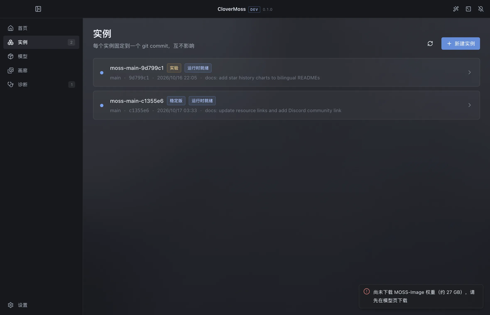

# 实现状态

- 快照日期：2026-10-19
- 应用版本：`0.1.0`（开发版）
- 设计与文档修订：v0.4
- 验证机器：Apple M3 / 16 GB / macOS 15.7.7
- 对应计划：[roadmap.md](roadmap.md)
- 文档索引：[README.md](README.md)

> 这是本项目**唯一的事实来源**。README、公告、架构文档里的能力描述如与本文冲突，
> 以本文为准。标记规则见 [docs/README.md](README.md#2-状态标记)。

## 1. 当前能跑什么

```bash
pnpm install
pnpm dev                 # 启动器 1180×760
pnpm build
pnpm typecheck
```

Harness/CI 若设置了 `ELECTRON_RUN_AS_NODE=1`，需临时去掉：

```bash
env -u ELECTRON_RUN_AS_NODE pnpm --filter @clover/desktop exec electron . --smoke
```

开发数据在 `.dev-data/`（已忽略）；不会写真实用户目录。

## 2. 完成度总表

| 模块 | 状态 | 说明 |
| --- | --- | --- |
| Electron 应用壳 | ✅ | 四窗口（每 kind 单例）、居中标题栏、深色/亚克力 |
| IPC + zod | ✅ | preload 白名单、主进程校验、统一错误 |
| 环境报告 | ✅ | 系统/GPU/内存/磁盘/Python/git/uv/网络/端口 + 推荐档位 |
| 公告/更新检查 | ✅ | manifest/公告缓存与镜像；**不安装更新** |
| 实例 | 🟡 | bare mirror/worktree/固定 SHA/删除/隔离；版本 pin 切换 UI 已接，未做完整回滚验收 |
| 运行时 | ✅ | 共享/独立 venv、lock hash、uv/pip、安装日志 |
| 模型/适配器 | 🟡 | 目录/下载/HF 缓存；适配器绑定/启用/强度 UI 已接；模型包绑定未做 |
| 画廊 | ✅ | 全局入口、自定义根、分页、元数据、`clover://` |
| 通知 | ✅ | 右上角单矩形、默认展开、非首页收起 |
| OOBE | ✅ | 单页三行、每次启动检查、可本次跳过 |
| 启动条/运行栈 | ✅ | Case/后端/实例/设备/档位/高级；运行态锁定 |
| 设备枚举 | ✅ | MPS / CUDA / CPU |
| 设备维护 | 🟡 | 设置内启用/禁用/重命名，启动条过滤；未做完整验收 |
| 训练并发 | 🟡 | 每 host 1 训练；本地训练时推理排队；强制并发/显存配额未做 |
| Case 配置 | 🟡 | `cases.json` 持久化；未单独做保存/重载端到端验收 |
| 队列落盘 | 🟡 | `launch-queue.json`；queued 保留、starting/running 重启标 failed；未做完整重启验收 |
| 队列运行 | 🟡 | 同设备默认 1 个；持久化行已接；强制并发未做 |
| 官方 Gradio | 🟡 | 启动/readiness/预检代码路径；缺 27 GB 权重，未真机验收 |
| xterm 终端 | ✅ | 推理/训练共用，stdout/stderr/stdin、停止/重启 |
| Supervisor | ✅ | spawn、readiness、取消、进程组、失败分类、日志 |
| runner | ✅ | NDJSON + `--simulate`；真实权重未验收 |
| 解析/诊断 | ✅ | tqdm/ANSI/下载条/规则/去重/toast 预算 |
| 创作台 | ✅ | Studio、画布、layout 编译、插入 Prompt |
| 创作生成 | ⬜ | 等 Clover 常驻后端；按钮只提示 |
| Project/图层 | ⬜ | 草稿只在内存；没有 Project 持久化 |
| 四窗口 UI v0.4 | ✅ | 启动器/创作/终端/训练；全局背景 |
| Kohaku Trainer 仓库 | ✅ | runtime clone、bare mirror、commit/worktree |
| Trainer 环境管理 | 🟡 | 本机/远端 venv、lock hash、install、doctor 代码路径；fake uv 验证，真实 CUDA 未 |
| 训练窗口 | ✅ | 表单、命令预览、doctor、状态卡 |
| 训练 Job | 🟡 | 本机/远端 `startTrainingJob` + step/loss + 终端；**fake ssh/模拟验证**，真实 CUDA 未跑 |
| 训练数据入口 | 🟡 | 检查/文本/潜变量缓存命令已拼装；未真实运行 |
| 训练导出/采样 | 🟡 | 本机/远端执行代码已接；fake 导出验证；真实 CUDA 未跑 |
| 训练产物登记 | 🟡 | 自动收集 export 文件、登记本地适配器；fake 验证；大文件/真实产物未验收 |
| SSH 主机探测 | ✅ | `trainer:host-test` 通过 fake ssh 验证 uname/git/uv/python/GPU/root |
| 远端仓库/版本 | 🟡 | 远端 mirror/worktree 创建/删除通过 fake ssh 验证；真实 host 未接 |
| 远端训练/导出 | 🟡 | 系统 ssh 训练/导出/取消代码已接；fake ssh 验证 step/loss/产物；真实 host 未接 |
| SSH host | ✅ | CRUD/测试 + `training-hosts.json`；不存密码 |
| SSH 远端执行 | 🟡 | 系统 ssh + 密钥、host probe、远端 mirror/worktree/venv/train/export 代码已接；只有 fake ssh 验证，无真实 host |
| WebUI | ⬜ | 没有 Fastify/SSE/HTTP API |
| 应用内更新安装 | ⬜ | 只检查，不下载/验签/安装 |
| 打包/公证 | ⬜ | 未做 |
| Windows 实机 | ⬜ | 未验证 |

## 3. 验证证据

以下结果来自本机实际运行，不是“代码里看起来有”。

| 验证 | 方式 | 结果 |
| --- | --- | --- |
| 构建/类型 | `pnpm build` / `pnpm typecheck` | 通过 |
| 自检 | `--smoke` | 通过；M3 / 16 GB / 网络镜像 |
| 四窗口创建 | `--scenario=windows` 与 `--screenshot` | 创作/终端通过 IPC 创建；训练窗口截图创建；四窗口均可渲染 |
| 训练器部署 | `--scenario=trainer-deploy` | clone trainer mirror、创建 `kohaku-3bcd751` worktree |
| 训练 Job | `--scenario=trainer-job` | `succeeded`，step 5、loss 0.1、5 行日志 |
| SSH host | `--scenario=trainer-host` | 保存/读取/删除成功（before 2 / after 1） |
| SSH 探测 | `--scenario=trainer-host-probe` | fake ssh 下 os/git/uv/python/root 解析成功 |
| 远端仓库/版本 | `--scenario=trainer-remote-local` | 远端 mirror、1 个分支、3 个提交、worktree 创建/删除 |
| 远端环境 | `--scenario=trainer-remote-env` | fake uv：runtime=ready，doctor=true |
| 远端训练 | `--scenario=trainer-remote-job` | fake ssh 下 succeeded，step 5、loss 0.1 |
| 远端产物 | `--scenario=trainer-remote-artifact` | 导出 Job succeeded，适配器自动登记 provider=local |
| 队列落盘 | `--scenario=queue-persist` | queued 行写入/读取/删除 |
| 缺权重预检 | 首页点击启动 | 生成 `E_MODEL` 诊断 + toast，不误下载 |
| layout 编译器 | Node 直接跑 `layout.ts` | 与官方示例逐字段一致 |
| 画廊 | `--screenshot` | 全局入口、分页、详情、背景交接 |
| 终端 | `--screenshot` | xterm 显示推理/训练日志，标题显示 step/loss |
| 训练 UI | `--screenshot` | training 页 + trainer 窗口 + 状态卡 |

截图：





## 4. 已确认的边界

1. **真实生成未验收**：本机没有 27 GB SFT 权重；官方 Gradio 只有代码路径和
   缺权重预检。真实 runner 生成也未跑过。
2. **真实 CUDA 训练未验收**：训练 Job/loss 是用 fake ssh/模拟 Python 输出验证的；
   `startTrainerRun` 的 CUDA/`kogine` 路径没有在 NVIDIA 机器执行。
3. **Trainer 环境安装未验收**：venv/uv/pip/doctor 代码存在，但本机没有安装
   CUDA 版依赖，也没有运行 trainer。
4. **SSH 只有 fake ssh 验证**：真实 host 的 host key/连接/远端 mirror/worktree/
   venv/Job 没有验收；当前代码路径已接。
5. **导出/采样真实 CUDA 未验收**：代码已接，fake 导出/登记通过；真实 `kogine` 未跑。
6. **Clover 常驻后端未实现**：没有本地 HTTP/WS；创作窗口“开始生成”不接任务。
7. **Project/图层未实现**：Studio 草稿只在内存；Project 与 Case 解耦只是设计。
8. **队列落盘未完整验收**：`launch-queue.json` 已接，queued 保留、starting/running
   重启标 failed；渲染层重启与自动重排还需要真实验收。
9. **官方 Gradio 未真实启动**：没有权重，未验证端口/readiness/浏览器显示。
10. **Windows/Linux 未实机验证**：目前只在 macOS arm64 测试。
11. **更新只检查不安装**：manifest/公告读取已接；下载、签名、安装未做。
12. **开发 CSP 仍允许 `unsafe-eval`**：打包前必须收紧。
13. **浅色主题已移除**：设置 schema 里仍有 `theme`，UI 固定深色；属于迁移残留。
14. **终端保留已完成任务**：便于回看日志，不是只显示运行中。

## 5. 明确没做（不是“下一轮顺手”）

- WebUI / 浏览器模式；
- 应用内更新下载与安装；
- 托管 Python；
- 设备维护完整验收/强制并发/显存配额；
- DMD 8 步采样器（当前 profile 只透传，仍走官方 pipeline）；
- 真实 SSH host / 真实 CUDA 验收；
- Clover 常驻后端 / Project / 图层；
- 打包、公证、Windows 安装器；
- 自研推理引擎（V2）。

## 6. 下一轮

按 [roadmap.md](roadmap.md) 的 P0 顺序：

1. 真实 SSH host 验收（host key/权限 → 远端 mirror/worktree/venv → 远端 Job/日志/取消）；
2. 真实 CUDA 训练验收 + 数据缓存/导出/采样；
3. Clover 常驻后端与 Project/图层；
4. 队列完整重启验收、Gradio/27 GB、设备维护；
5. WebUI/更新、打包。
